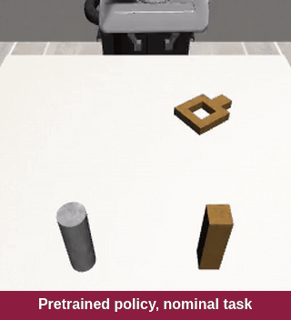
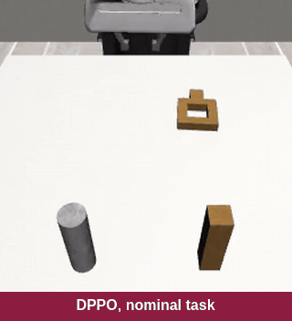
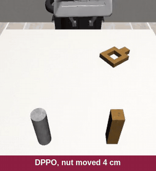
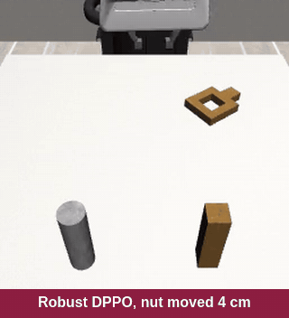
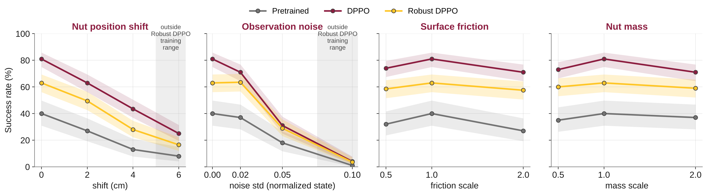
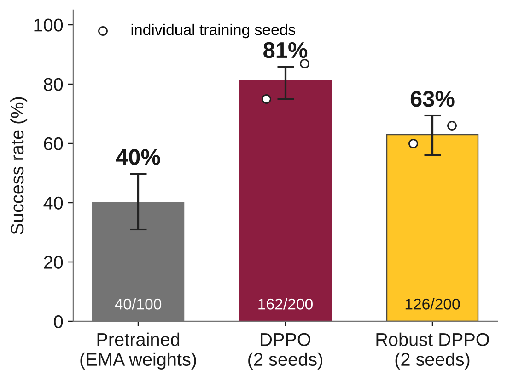
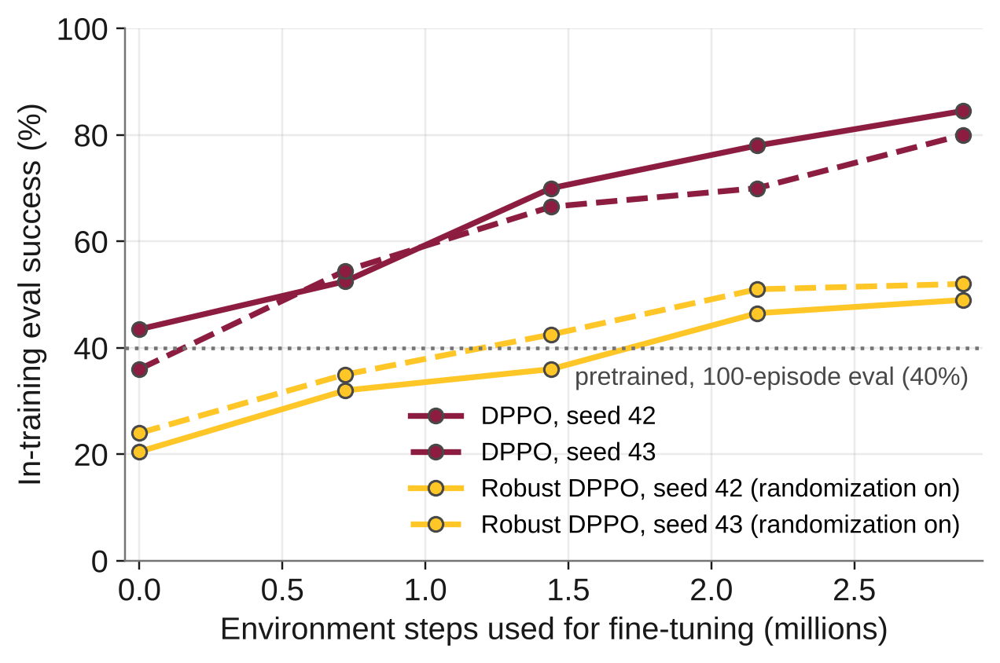
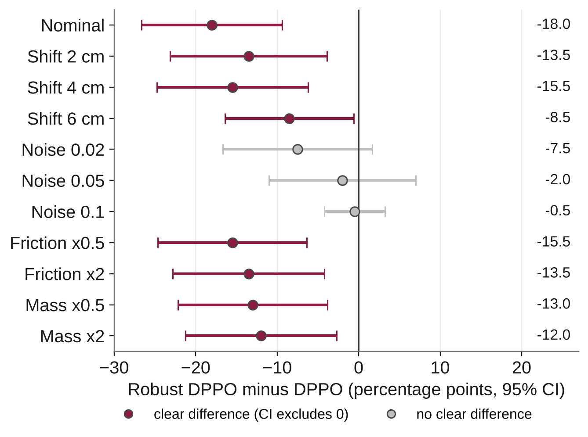

<p align="center">
  <picture>
    <source media="(prefers-color-scheme: dark)" srcset="media/banner-dark.svg">
    <source media="(prefers-color-scheme: light)" srcset="media/banner-light.svg">
    
  </picture>
</p>
<p align="center">
  
  
  
  
  
</p>

# Does RL fine-tuning make a robot policy robust?

Fine-tuning a diffusion policy with **DPPO** on the Robomimic *Square* task, then stress-testing it under 10 perturbations: moving the nut, adding sensor noise, and changing friction and mass.

<table>
  <tr>
    <td align="center"><br><sub>Pretrained policy</sub></td>
    <td align="center"><br><sub>After DPPO</sub></td>
    <td align="center"><br><sub>DPPO, nut moved 4 cm</sub></td>
    <td align="center"><br><sub>Robust DPPO, nut moved 4 cm</sub></td>
  </tr>
</table>

<sub>Real evaluation episodes from my runs (1.5x speed). The robot has to grasp a square nut and drop it over a peg.</sub>

This started as my final project for EEE 598 (Reinforcement Learning) at Arizona State University, fall 2026. Everything here, from the perturbation code to the training runs and the analysis, runs end to end from one Colab notebook.

## The short version

| | Nominal success |
|---|---|
| Pretrained diffusion policy (learned from human demos) | **40%** |
| After DPPO fine-tuning | **81%** |
| Robust DPPO (DPPO + domain randomization) | **63%** |

- **DPPO roughly doubles the success rate** (+41 points, 95% CI +/-11), and the gain holds under almost every perturbation I tried.
- **Training with randomization did not make the policy more robust at my compute budget.** Robust DPPO was clearly worse than plain DPPO in 8 of 11 conditions and never better. Relative to its own starting point it degraded slightly less (67% vs 65% of nominal success kept), but it started 18 points lower.
- **Noise is the real weak spot.** At an observation noise std of 0.1, every policy drops below 5%.

## Background in two lines

A **diffusion policy** turns random noise into an action in 20 small denoising steps. **DPPO** ([Ren et al., ICLR 2025](https://arxiv.org/abs/2409.00588)) treats each of those steps as a decision, so PPO can fine-tune the policy with a simple success/failure reward. I fine-tune the last 10 steps.

## What I tested

| Family | Test levels | Robust DPPO trained on |
|---|---|---|
| Nut position shift | 2, 4, 6 cm | 0 to 4 cm |
| Observation noise (std, normalized state) | 0.02, 0.05, 0.1 | 0 to 0.05 |
| Friction (all surfaces) | x0.5, x2 | x0.5 to x2 |
| Nut mass | x0.5, x2 | x0.5 to x2 |

The 6 cm shift and the 0.1 noise level are outside the training range on purpose, to check generalization.

Every number comes from **100 evaluation episodes per condition per training seed**. Every policy sees the same starting states, so differences come from the policy and not from luck.

## Results



<table>
  <tr>
    <td></td>
    <td></td>
  </tr>
  <tr>
    <td><sub>Nominal success with 95% Wilson intervals; dots are individual training seeds.</sub></td>
    <td><sub>Success during training. Robust DPPO's curve was still rising when the budget ran out.</sub></td>
  </tr>
</table>

<p align="center"></p>

Full table with intervals: [`results/table_main.md`](results/table_main.md). Every evaluation as a CSV: [`results/results_all_evaluations.csv`](results/results_all_evaluations.csv).

Side-by-side clips (4 episodes each, same starting states): [pretrained vs DPPO](media/demo1_pretrained_vs_dppo_nominal.mp4) and [DPPO vs Robust DPPO with the nut moved 4 cm](media/demo2_dppo_vs_robust_shift4cm.mp4).

## What I built

To run the whole study on one Colab GPU without babysitting it, I added these on top of the official DPPO code:

- **A perturbation wrapper** ([`src/perturb.py`](src/perturb.py)). It subclasses DPPO's Robomimic wrapper and can shift the nut, add noise to the observed state, and scale friction and mass. With `dr=True` it samples a new random world every episode for Robust DPPO. With everything off it behaves exactly like the original, so baseline numbers don't move.
- **A self-test** ([`src/perturb_selftest.py`](src/perturb_selftest.py)). It checks that the perturbations do what they should before any compute is spent: a 4 cm shift measures 4.00 cm, friction x2 measures x2.0, mass x0.5 measures x0.5, and the default settings give identical observations.
- **Resumable training** ([`src/dppo_run_resumable.py`](src/dppo_run_resumable.py)). The fine-tuning script saves checkpoints but always starts from iteration 0. This launcher patches the trainer to load the newest checkpoint and continue, so a Colab disconnect costs minutes instead of hours.
- **A job pipeline** ([`src/pipeline.py`](src/pipeline.py)). It runs every training and evaluation job in priority order and skips anything already finished. It detects stalled jobs, retries failures, and writes a live status table to Google Drive with an ETA. You can stop it or skip a job by dropping a `STOP` or `SKIP_<job>` file in the Drive folder.
- **Analysis** ([`src/analyze.py`](src/analyze.py)). It pools seeds and computes Wilson intervals for each method and condition, difference intervals between methods, and Fisher exact tests, then writes the tables and figures.

The whole run was 4 fine-tuning runs of 2.88 M environment steps each (about 5 h per run on an NVIDIA L4), plus 5,600 evaluation episodes: 64 jobs in total, 0 failed.

## Run it yourself

The easiest way is Colab:

1. Open [`notebooks/dppo_robustness_colab.ipynb`](notebooks/dppo_robustness_colab.ipynb) in Google Colab and pick an **L4** GPU runtime. The simulator is CPU-heavy, so an A100 burns compute units for little speed-up.
2. **Runtime > Run all.** It installs DPPO (pinned commit) with robosuite 1.4.1, robomimic 0.5.0 and MuJoCo 3.1.6, and downloads the authors' pretrained Square checkpoint. Then it runs the self-tests and starts the pipeline.
3. If the runtime disconnects, reconnect and run all again. Finished jobs are skipped and training resumes.
4. Part 2 of the notebook builds the tables, figures and videos from whatever has finished.

The notebook carries its own copy of the code in `src/`, so it runs standalone.

To use the wrapper in your own DPPO checkout:

```bash
git clone https://github.com/irom-princeton/dppo.git
python src/install_into_dppo.py dppo
# then, for example, evaluate with the nut moved 4 cm:
cd dppo && python script/run.py --config-dir=cfg/robomimic/eval/square --config-name=eval_diffusion_mlp \
    base_policy_path=<your checkpoint> +env.wrappers.robomimic_lowdim.shift_cm=4.0
```

## Things worth knowing

- **Pretrained weights.** The authors' checkpoint stores both raw and EMA weights. DPPO fine-tunes from EMA, but the evaluation script loads raw. I report EMA (40%) as the baseline; raw scores 37%, which is not a meaningful difference.
- **Small samples mislead.** An earlier 20-episode check had put the pretrained policy at 25%; 100 episodes put it at 40%.
- **Compute budget.** Each run is about 1/5 of the paper's default training budget for this task. That is enough for DPPO but probably not for Robust DPPO, whose harder randomized task gives fewer successes to learn from early on.
- **Simulation only, state-based policy, 2 training seeds.**

## Repo layout

```
src/            perturbation wrapper, self-test, resumable launcher, pipeline, analysis
notebooks/      the Colab notebook that ran everything
results/        final tables, per-evaluation CSV, key numbers
media/          GIFs, figures, side-by-side videos
```

## Credits

- DPPO: Allen Z. Ren et al., *Diffusion Policy Policy Optimization*, ICLR 2025 ([code](https://github.com/irom-princeton/dppo)). The pretrained Square checkpoint and normalization file are theirs.
- Diffusion Policy: Cheng Chi et al., RSS 2023. Robomimic: Mandlekar et al., CoRL 2021. Simulation: robosuite and MuJoCo.

Released under the MIT License (see `LICENSE`).
